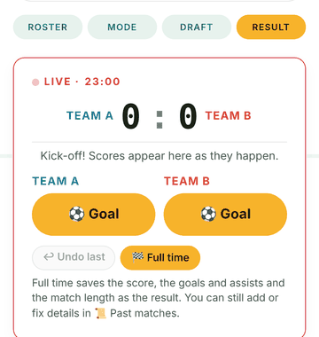
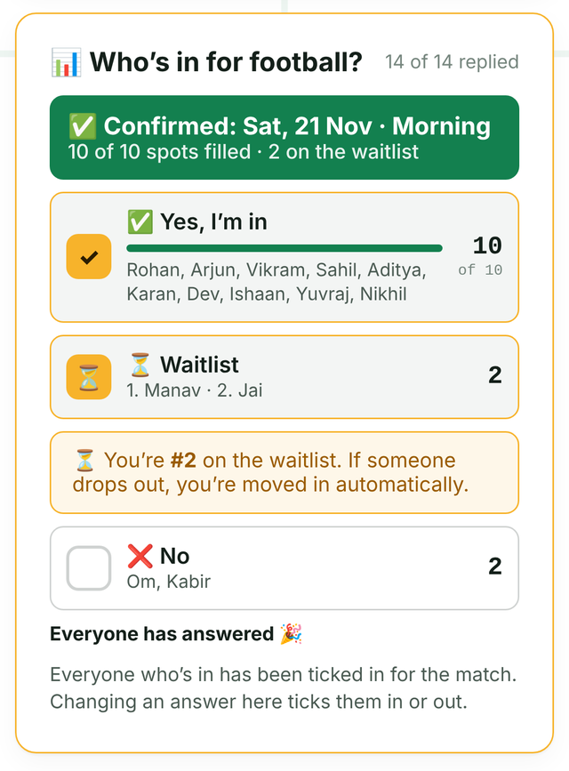
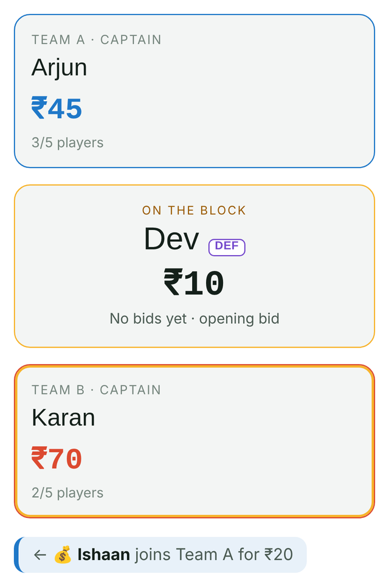
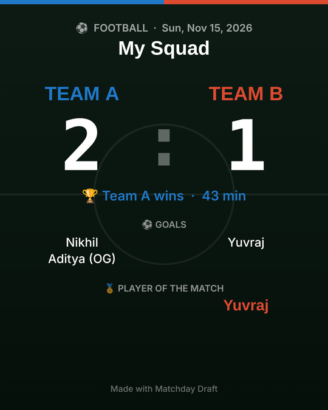
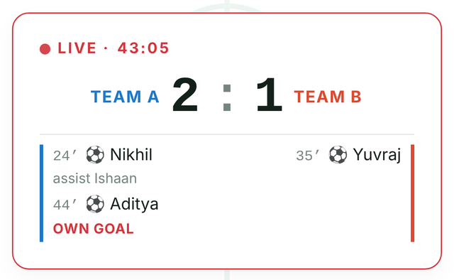
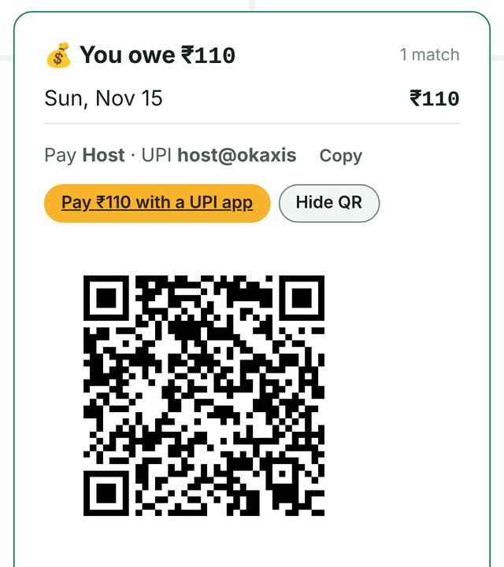
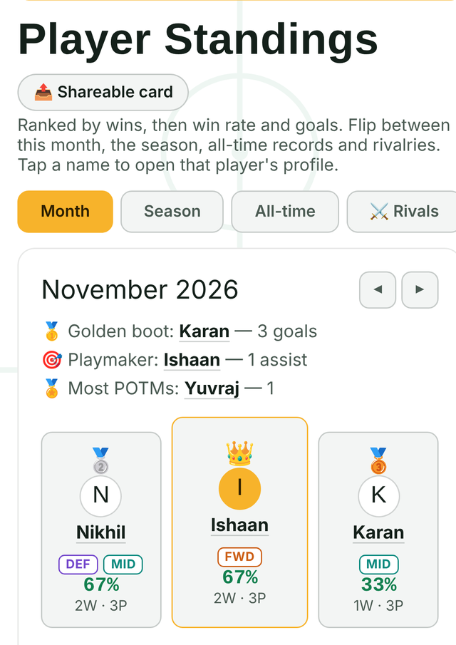

# ⚽ Matchday Draft


**▶ Try the demo:** https://keeratbrar007.github.io/matchday-draft/?demo=1 (made-up players and matches, no sign-up; open it in two tabs to see live sync)

**Live app:** https://keeratbrar007.github.io/matchday-draft/

Matchday Draft is a web app for running a weekly pickup game with friends. It covers who's playing, building fair teams, scoring, and splitting the turf money, so the group doesn't need WhatsApp polls, spreadsheets and mental maths.

It's a single HTML file that installs on a phone like an app. Everyone's phone stays in sync in real time through Firebase.

<p align="center">
  
</p>

<p align="center">
  
  
  
</p>
<p align="center">
  
  
  
</p>

<sub>Screenshots use made-up demo players.</sub>

---

## Features

**Who's playing**
- "Who's in?" polls that replace the WhatsApp poll, with one or more time slots (always including "No"), one-tap vote links for WhatsApp, and a "seen but not replied" list.
- Spots and a waitlist: the first to say yes get the spots, everyone after waits in order and moves in automatically when someone drops out.
- One tap re-creates last week's poll for the same day next week.
- Today's player list updates itself from the poll.

**Fair teams**
- Player database with positions and skill ratings per sport. Drag to reorder, and drag across the list to select many players at once.
- Auto-balanced teams, or a live captains' auction where captains bid any amount from their own phones.
- Rankings that learn from results: winners move up, more for long games, big margins and upsets.
- Guests, tagged with whose guest they are (one player, several, or everyone).

**Matches and stats**
- Live scoring: big +1 buttons during the match that update every phone, each team's goals listed on its own side (own goals included), and the result saves itself at full time.
- A result card image (score, scorers, player of the match) to share straight to WhatsApp.
- Match history, leaderboards, player-of-the-match voting, rivalries, attendance and seasons.

**Multiple sports**
- Football, cricket, basketball and pickleball, each with its own theme, background, positions, abilities and stats (goals/assists, runs/wickets, points/rebounds, etc.).
- Each game has its own player list. Friends only see the games they've been added to.

**Turf money**
- Split costs equally or with custom amounts, including things players paid for themselves (like water).
- Mark who's paid, before or after sending the breakdown.
- Friends see what they owe, with a UPI pay link and a QR code for the exact amount.
- WhatsApp nudges for anyone who still owes.

**Host controls**
- One host, unlocked with a private host link; everyone else logs in with just their name (optional PIN).
- Backup and restore of all data.

**Demo mode** (`?demo=1`)
- Opens the whole app with generated sample data (two games, 26 players, 15 past matches) and never connects to the database, so real groups' data can't be seen or changed.
- Visitors start as the host and can switch to any player's view; saved settings are namespaced so the demo can't overwrite a real login on the same phone.
- Two demo tabs stay in sync through browser storage events, to show the live updates a real group gets.

---

## How it's built

| Part | What's used |
|---|---|
| App | Plain HTML, CSS and JavaScript (no framework), written as small modules in `src/` and built into one self-contained `index.html` by a zero-dependency Node script |
| Install / offline | Web app manifest + service worker (installable PWA with update prompts) |
| Database | Firebase Cloud Firestore with real-time listeners |
| Sign-in | Firebase anonymous auth; the host proves a private code once per phone |
| Security | Firestore security rules: only the host can change data, friends can only change their own answers, and each phone can only read the games its player is in |
| QR codes | Generated in the browser (bundled MIT-licensed encoder) |
| Hosting | GitHub Pages, published by GitHub Actions |

The host code is never stored in the app. The app only contains a SHA-256 fingerprint of it, and the real check happens in the database rules.

---

## Automatic tests

Every push to `main` builds the app and runs the full test suite on GitHub Actions before the site goes live (see [`.github/workflows/checks.yml`](.github/workflows/checks.yml)):

- **21 end-to-end suites (about 580 checks)** written with [Playwright](https://playwright.dev). They drive the app on emulated iPhones, with several phones (host and friends) open at once.
- The tests run against a **mock Firestore** that enforces the same rules as the real database, so they also check that friends *can't* do things they shouldn't, like editing results, reading other games, or claiming to be the host.
- Every suite runs twice, once under the current database rules and once under the game-privacy rules.
- The site is published only if everything passes. A failed run leaves the last good version live, and the logs and screenshots are kept as build artifacts.

Build and run them locally:

```bash
node build.js                        # src/ -> dist/index.html
cd tests
npm install && npx playwright install chromium
pip install opencv-python-headless   # used to scan the generated UPI QR codes
python3 prepare.py                   # builds the app, then a test copy that uses the mock database
bash run.sh current                  # or: bash run.sh privacy
```

---

## Repository layout

```
src/index.html          page shell (head, meta tags, where the CSS and JS go)
src/css/                styles: theme, layout, players and teams, auction, features
src/js/                 the app, one file per area, joined in file-name order:
                          01-state  02-sports  03-persistence (Firestore + auth, config)
                          04-matchmaking (team balancing)  05/06 database + match flow
                          07-results (rankings that learn)  08-11 rendering
                          13-turf-money  14-live-score  15-result-card  16-polls
                          17-numbers  18-backup  19-profile  20-alerts  21-22 stats
                          23-attendance  23-demo  24-boot  (12 is the bundled QR encoder)
build.js                joins src/ into dist/index.html (no dependencies)
sw.js                   service worker (offline + updates)
manifest.webmanifest    install info and icons
*.png                   app icons
docs/                   README screenshots
tests/                  Playwright suites, mock database, test runner
.github/workflows/      check-and-publish workflow
```

---

## Using it for your own group

1. Create a free Firebase project with Firestore and anonymous sign-in turned on.
2. Put your project's web config into `FIREBASE_CONFIG` in `src/js/03-persistence.js`.
3. Pick a host code. Put its SHA-256 into `HOST_HASH` in `src/js/01-state.js`, and the code itself into your Firestore security rules (never into the repository).
4. Run `node build.js` and host `dist/index.html` with the icons, `sw.js` and the manifest on GitHub Pages (or any static host), and open `your-site/#host=YOUR_CODE` once on the host's phone.

---

Built by Keerat Brar.
